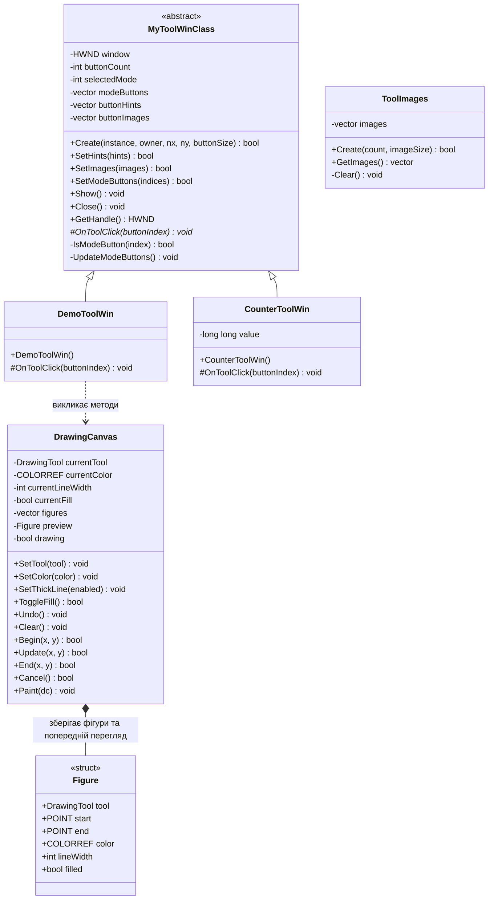

# Діаграма класів

## Пояснення

- MyToolWinClass — абстрактний клас багаторазово використовуваного
  модуля ToolWin.
- DemoToolWin і CounterToolWin успадковують його та визначають
  власні дії кнопок через OnToolClick().
- DemoToolWin звертається до окремого об’єкта DrawingCanvas.
  Поля DrawingCanvas у самому DemoToolWin немає.
- Figure — вкладена структура класу DrawingCanvas.
  Завершені фігури та попередній перегляд зберігаються за значенням.
- ToolImages створює зображення і володіє ними. У головному файлі
  програми їхні дескриптори передаються до ToolWin через SetImages().
- ToolWin не залежить від класів DrawingCanvas і ToolImages.

Позначення:
- «+» — public;
- «−» — private;
- «#» — protected;
- порожній трикутник — успадкування;
- пунктирна стрілка — залежність;
- зафарбований ромб — композиція.

Для читабельності на діаграмі скорочено типи контейнерів
і не показано службові обробники повідомлень, деструктори
та заборонені операції копіювання.