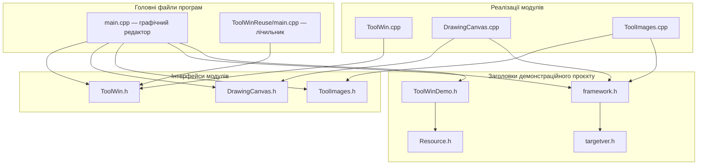

# Діаграма include-залежностей

Стрілка спрямована від файлу, який виконує #include,
до заголовка, який він підключає.

## Пояснення

- Обидві програми підключають один і той самий ToolWin.h.
- Обидва проєкти компілюють той самий ToolWin.cpp.
- Файли .cpp компілюються окремо, а не підключаються через #include.
- ToolWin.cpp не підключає framework.h та не залежить
  від заголовків графічного редактора.
- DrawingCanvas і ToolImages використовуються лише
  демонстраційним графічним редактором.
- Діаграма показує локальні залежності вихідного коду C++.
  Стандартні заголовки C++ та заголовки Windows SDK опущено.
- Ресурсний файл ToolWinDemo.rc компілюється окремо
  і також використовує Resource.h.